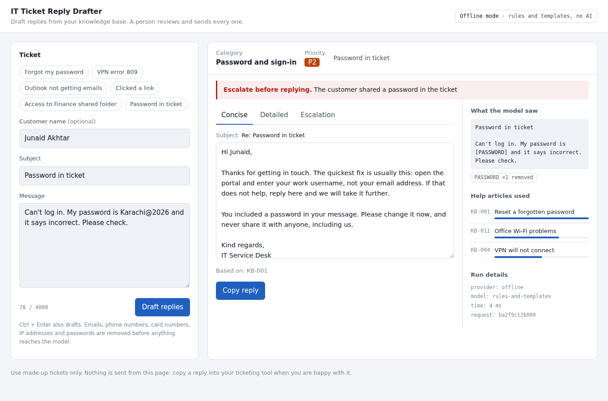
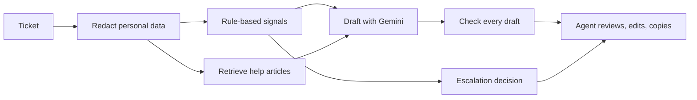

# IT Ticket Reply Drafter

Drafts safe replies to IT support tickets, grounded in the company's own help articles, for a human agent to review and send.

Built for first-line service desks: the agent pastes a ticket and gets a category, a priority, an escalation check and three reply drafts. Every draft is checked against safety rules before the agent can copy it. Nothing is ever sent automatically.



## What it does

| Step | What happens |
|---|---|
| Redact | Emails, phone numbers, card numbers, IP addresses and shared passwords are removed before the ticket reaches the model or the logs. |
| Signal | Rules flag possible security incidents, outages, data loss and shared credentials. These always force an escalation, whatever the model says. |
| Retrieve | The most relevant help articles are found in the knowledge base (local TF-IDF by default, optional Gemini embeddings). |
| Draft | The model writes three replies (concise, detailed, escalation) using only those articles, and cites the article ids it used. |
| Check | Every draft is checked for asking for a password or code, promising a timeline or refund, leaking personal data, and citing articles that do not exist. A failing draft is blocked until the agent edits it and it passes again. |
| Log | Metadata only (category, priority, flags, latency). No ticket text is written to disk. |

## Why it is built this way

A model that writes a nice reply is easy. A model that a service desk can trust needs limits:

- **Grounded, not guessed.** Steps come from the help articles, and the draft says which ones.
- **Rules beat the model.** Escalation for security and outages is decided by rules that are tested, not by the model's mood.
- **A person stays in charge.** Drafts are suggestions. The agent edits, re-checks and copies.
- **Measured.** A 30-ticket evaluation set with known answers scores every change.

## Architecture



- **Backend:** FastAPI, Pydantic models as the API contract
- **Model:** Gemini (free tier) with a JSON response schema, low temperature, retry on rate limits
- **Retrieval:** scikit-learn TF-IDF (free, local) or Gemini embeddings with an on-disk cache
- **Offline mode:** with no API key, a rules-and-templates drafter keeps the app, the tests and the evaluation working
- **Front end:** one HTML page, no build step, light and dark themes, works on mobile
- **Quality:** pytest suite (including the Gemini path with a mocked client), evaluation script, GitHub Actions CI, Docker

## Run it locally

```bash
git clone https://github.com/ahtishammohyuddin/it-ticket-reply-drafter.git
cd it-ticket-reply-drafter
python -m venv .venv
.venv\Scripts\activate          # Windows. On macOS or Linux: source .venv/bin/activate
pip install -r requirements-dev.txt
copy .env.example .env          # macOS or Linux: cp .env.example .env
uvicorn app.main:app --reload
```

Open http://127.0.0.1:8000. Without a key it runs in offline mode, labelled at the top of the page.

To use Gemini, get a free key at https://aistudio.google.com/apikey and put it in `.env` as `GEMINI_API_KEY=...`. Restart the server. The API docs are at http://127.0.0.1:8000/docs.

## Tests and evaluation

```bash
pytest -q                      # 25 tests, no key or network needed
python -m eval.run_eval        # scores 30 made-up tickets, writes eval/results.md
```

Offline baseline (rules and templates, no AI):

| Metric | Result |
|---|---|
| Category accuracy | 26/30 (87%) |
| Right article in top 3 | 25/27 (93%) |
| Escalation recall | 7/8 (88%) |
| Escalation precision | 7/7 (100%) |
| Drafts blocked by guardrails | 0/90 |

Gemini (`gemini-3.5-flash-lite`, free tier), three runs on the same 30 tickets:

| Metric | First run | After defining escalation | Final (email formatting, redaction fix) |
|---|---|---|---|
| Category accuracy | 28/30 (93%) | 27/30 (90%) | 26/30 (87%) |
| Right article in top 3 | 25/27 (93%) | 25/27 (93%) | 25/27 (93%) |
| Escalation recall | 8/8 (100%) | 8/8 (100%) | 8/8 (100%) |
| Escalation precision | 8/13 (62%) | 8/10 (80%) | 8/11 (73%) |
| Drafts blocked by guardrails | 0/90 | 1/90 | 0/90 |

What changed and why:

- The first run escalated five tickets a first-line agent could handle, because the prompt never defined escalation. A one-paragraph definition cut that to two or three per run without missing a real escalation. Recall matters most here: missing a security ticket costs far more than an extra escalation.
- In the second run one draft was blocked. The logs showed a false alarm: the redaction rule treated normal sentences such as "your password is compromised" as a leaked password. A value now only counts as a password if it contains a digit or a symbol. Regression tests cover both sides.
- The final run added email formatting (greeting, numbered steps, sign-off, no article codes in the text).
- Differences of one ticket between runs are normal model variation. The retrieval misses are gaps in the knowledge base (no article for unknown sign-in alerts), not bugs.

## API

| Method | Path | Purpose |
|---|---|---|
| GET | `/api/health` | Provider, model, retriever and article count |
| POST | `/api/draft` | Ticket in, analysis and three checked drafts out |
| POST | `/api/check` | Re-check a draft after the agent edits it |
| GET | `/api/kb` | List the help articles |
| GET | `/api/samples` | Example tickets for the demo |

## Project structure

```
app/          FastAPI app, pipeline, redaction, guardrails, retrieval, drafters
data/kb/      Help articles, one Markdown file each (fictional company)
data/eval/    30 made-up tickets with expected answers
eval/         Evaluation script and latest results
static/       The agent console (single HTML file)
tests/        pytest suite
docs/         Deployment guide
```

## Cost

Free to build, run and host:

- Gemini free tier (`gemini-3.5-flash-lite`) for drafting, no billing account needed
- TF-IDF retrieval runs locally and uses no API calls
- Hosting on Hugging Face Spaces free CPU (see [docs/DEPLOY.md](docs/DEPLOY.md))
- The demo limits each visitor to a few drafts per minute to protect the free quota

On the free tier, Google may use prompts to improve its models. Only use made-up tickets, never real customer data. A real deployment would use a paid tier or a self-hosted model.

## Limitations

- The knowledge base is 12 short fictional articles. A real desk would load its own.
- Redaction uses patterns. It catches common formats, not every possible form of personal data, such as names in free text.
- The rate limiter is in memory, so it resets when the app restarts and does not share state across several servers.
- Offline mode is a fallback for demos and tests, not a replacement for the model.

## License

MIT
